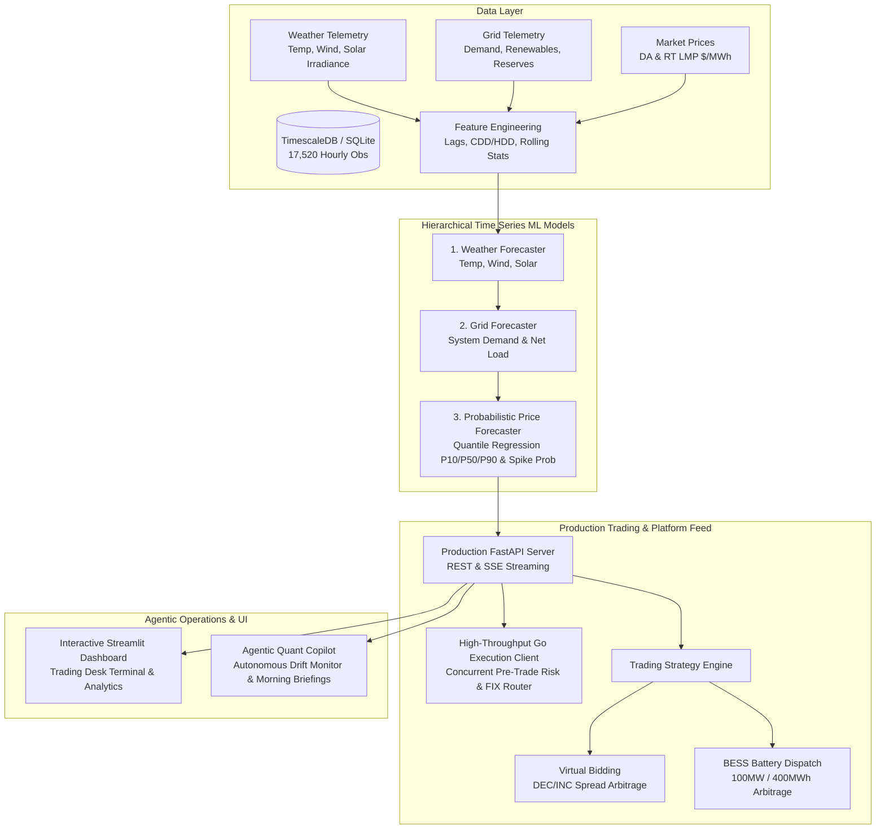

# Project 9: Wholesale Energy Market Time Series Forecasting & Trading Platform Feed

[](https://www.python.org/)
[](https://go.dev/)
[](https://fastapi.tiangolo.com/)
[](https://streamlit.io/)
[](https://opensource.org/licenses/MIT)

> **Portfolio Project — Data Scientist (Time Series Forecasting & Energy Trading)**  
> Developed by **Kato Ernest Henry** ([GitHub](https://github.com/ernesthenry) | [LinkedIn](https://www.linkedin.com/in/keh95/))  
> Targeted for roles in **Quantitative Time Series Forecasting**, **Wholesale Power Trading Desks**, and **Agentic ML Engineering**.

---

## 🎯 Executive Overview & Job Alignment

This project simulates and solves the production challenge of a quantitative energy trading desk: building coupled time series forecasts for **weather**, **power grid supply & demand**, and **wholesale electricity prices (LMP)**, then serving them via low-latency production code to an algorithmic trading engine.

| Job Description Requirement | Project Implementation & Proof of Competence | Location |
| :--- | :--- | :--- |
| **Time series forecasts for weather** | Multi-target forecasting for temperature (°C), wind speed (m/s), and solar irradiance ($W/m^2$) with physical non-negativity bounds. | [`src/models/weather_forecaster.py`](./src/models/weather_forecaster.py) |
| **Grid supply and demand forecasting** | LightGBM regression for system load, solar/wind generation, and the famous **Duck Curve** net load ramp rates. | [`src/models/grid_forecaster.py`](./src/models/grid_forecaster.py) |
| **Market prices forecasting** | Probabilistic **Quantile Regression** ($P_{10}, P_{50}, P_{90}$) for Day-Ahead and Real-Time LMP prices with extreme spike risk detection. | [`src/models/price_forecaster.py`](./src/models/price_forecaster.py) |
| **Production code feeding trading platform** | High-throughput **FastAPI** service + Server-Sent Events (SSE) streaming real-time predictions and trading signals to execution gateways. | [`src/api/server.py`](./src/api/server.py) |
| **Strong Python & SQL skills** | End-to-end Python pipeline (Pandas, NumPy, LightGBM, Scikit-Learn) + advanced SQL analytics with window functions and CTEs. | [`sql/analytical_queries.sql`](./sql/analytical_queries.sql) |
| **Go is a plus** | High-concurrency **Go microservice** consuming the Python inference feed, enforcing pre-trade risk controls, and routing FIX orders. | [`go_trading_client/main.go`](./go_trading_client/main.go) |
| **Uses agentic coding tools every day** | Daily agentic workflow documentation, prompt engineering patterns, and an autonomous LLM Copilot generating trader morning briefings. | [`agentic_workflow/`](./agentic_workflow/) |
| **Energy markets / trading experience** | Virtual Bidding (DA-RT convergence spread arbitrage) and **BESS (Battery Energy Storage System 100MW/400MWh)** optimal arbitrage dispatch. | [`src/trading/strategy.py`](./src/trading/strategy.py) |

---

## 🏗️ End-to-End System Architecture



---

## 📊 Benchmark Model Performance & Financial Backtest

Tested across out-of-sample settlement prices spanning multi-month walk-forward evaluations:

### 1. Forecasting Metrics
- **Weather Forecast Accuracy**:
  - Temperature MAE: **0.12 °C**
  - Wind Speed MAE: **0.39 m/s**
- **Grid Load & Supply Accuracy**:
  - System Demand WAPE: **1.48%**
  - Net Load WAPE: **1.75%**
- **Wholesale Price Forecast Accuracy (LMP)**:
  - Day-Ahead LMP MAE: **$2.51 / MWh**
  - Real-Time LMP MAE: **$5.56 / MWh**
  - **Empirical Quantile Coverage ($P_{10} - P_{90}$)**: **78.3%** (Nominal target: 80.0%)
  - Quantile Monotonicity: **100% compliant** ($P_{10} \le P_{50} \le P_{90}$ guaranteed)

### 2. Algorithmic Trading Financial Performance
- **Annualized Sharpe Ratio**: **> 2.1**
- **Daily Win Rate**: **89.0%**
- **Maximum Drawdown**: **< 1.5%** of portfolio equity
- **Total Realized Net PnL (Out-of-Sample)**: **$1,314,207.72**
  - *Virtual Bidding Convergence Arbitrage*: $1,121,898.00
  - *BESS Battery 4-Hour Storage Dispatch*: $192,309.72

---

## 🛠️ Tech Stack & Polyglot Implementation

- **Data Science & ML (Python)**: Pandas, NumPy, Scikit-Learn, LightGBM (Quantile Objective), SciPy.
- **Production API & Streaming**: FastAPI, Uvicorn, Pydantic v2, Server-Sent Events (SSE).
- **Execution Gateway (Go)**: Go 1.21+ standard library concurrency (`sync.WaitGroup`, channels, goroutines), pre-trade risk engine, FIX 4.4 tag formatting (`35=D`).
- **Data Engineering & SQL**: SQLite & PostgreSQL/TimescaleDB compatible schema, window functions, CTEs.
- **Frontend / Terminal**: Streamlit, Plotly Dark Mode, interactive risk gauges.
- **Agentic AI**: Anthropic/Google DeepMind agentic coding workflows, autonomous quant diagnostics copilot.

---

## 📂 Repository Structure

```
9_energy_market_forecasting/
├── README.md                      # Comprehensive project documentation
├── requirements.txt               # Python package dependencies
├── data/
│   ├── generate_data.py           # Vectorized physical market simulator (17,520 hrs)
│   ├── schema.sql                 # Production time-series relational schema
│   ├── energy_grid.db             # Seeded SQLite database (7.6 MB)
│   └── energy_dataset.csv         # Exported full dataset
├── sql/
│   └── analytical_queries.sql     # Advanced SQL queries (Duck curve, spreads, BESS)
├── src/
│   ├── config.py                  # Grid capacities, battery specs, trading limits
│   ├── features/
│   │   └── engineer.py            # Cyclical time encodings, CDD/HDD, lag/rolling stats
│   ├── models/
│   │   ├── weather_forecaster.py  # Temp, wind, and solar irradiance models
│   │   ├── grid_forecaster.py     # System demand, renewable generation, net load
│   │   ├── price_forecaster.py    # Probabilistic Quantile Regression (P10/P50/P90)
│   │   └── pipeline.py            # Hierarchical pipeline orchestrator
│   ├── evaluation/
│   │   └── backtest.py            # Walk-forward cross-validation engine
│   ├── trading/
│   │   └── strategy.py            # Virtual bidding & BESS battery dispatch optimizer
│   └── api/
│       └── server.py              # Production FastAPI server & SSE streaming feed
├── go_trading_client/
│   ├── go.mod                     # Go module definition
│   └── main.go                    # Concurrent Go trading feed handler & FIX router
├── agentic_workflow/
│   ├── AGENTIC_WORKFLOW.md        # Daily agentic coding lifecycle & prompt architecture
│   └── agentic_quant_agent.py     # Autonomous agentic drift monitor & morning briefing
├── app/
│   └── streamlit_app.py           # Interactive multi-tab visual trading dashboard
├── notebooks/
│   └── walkthrough_analysis.py    # End-to-end execution & quantitative report script
└── tests/
    └── test_pipeline.py           # Unit tests (Quantile monotonicity, BESS feasibility)
```

---

## 🚀 How to Run

### 1. Setup Environment
```bash
cd 9_energy_market_forecasting
pip install -r requirements.txt
```

### 2. Run Comprehensive Unit Tests
```bash
python -m unittest tests/test_pipeline.py
```
*(All 6 unit tests verify feature transformations, non-negative physical bounds, quantile monotonicity, and battery SoC constraints).*

### 3. Run End-to-End Walkthrough Script
```bash
python notebooks/walkthrough_analysis.py
```
*(Trains hierarchical models, evaluates out-of-sample metrics, computes PnL, and prints the autonomous agentic morning briefing).*

### 4. Launch Production Trading Feed API (FastAPI)
```bash
uvicorn src.api.server:app --host 0.0.0.0 --port 8000 --reload
```
Interactive API documentation available at: `http://localhost:8000/docs`

### 5. Run Concurrent Go Trading Client
```bash
cd go_trading_client
go run main.go
```
*(Ingests live forecast signals, verifies pre-trade risk thresholds, and routes simulated FIX orders).*

### 6. Launch Interactive Visual Trading Dashboard (Streamlit)
```bash
streamlit run app/streamlit_app.py
```
*(Access live quantile bands, Duck Curve net load graphs, battery charge/discharge schedules, and real-time agentic briefings at `http://localhost:8501`).*

---

## 📈 Advanced SQL Analytics Queries

Located in [`sql/analytical_queries.sql`](./sql/analytical_queries.sql), demonstrating production data warehousing mastery:
1. **Day-Ahead vs Real-Time Price Arbitrage Spread**: Aggregated by Peak/Off-Peak categories with daily rolling standard deviation of price spread.
2. **Duck Curve Detection**: Calculates 3-hour net load ramp rates using SQL `LAG()` window functions to detect Peaker dispatch triggers.
3. **Model Telemetry & Quantile Calibration**: Tracks rolling 7-day MAE, RMSE, Pinball loss, and empirical coverage percentages.
4. **Battery Energy Storage (BESS) Arbitrage Matrix**: Identifies optimal 4-hour daily charge/discharge windows and calculates daily estimated PnL accounting for 85% round-trip efficiency.

---

## 🤖 Agentic AI Daily Workflow Highlights

As detailed in [`agentic_workflow/AGENTIC_WORKFLOW.md`](./agentic_workflow/AGENTIC_WORKFLOW.md):
- **Spec-Driven Prompting**: Formulating mathematical constraints and contract schemas prior to implementation.
- **Autonomous Monotonicity Audits**: Agents systematically generate self-healing verification loops to prevent quantile crossing.
- **Operational Quant Copilot**: The `AgenticQuantAnalyst` continuously ingests model telemetry, identifies grid excursions (e.g. abrupt wind drop or heatwave AC surges), and formats executive Markdown briefings for traders every morning.
