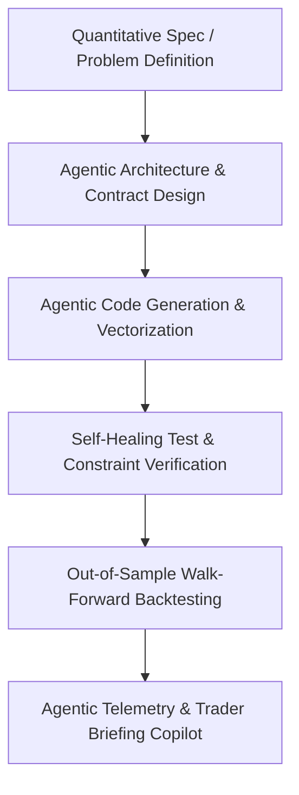

# Agentic Coding Daily Development Workflow

This document details how **agentic AI coding tools** (such as Google Antigravity, Claude Code, and specialized LLM agents) are integrated into the daily quantitative development lifecycle for energy market forecasting and trading platform engineering.

---

## 1. Why Agentic Coding in Quantitative Energy Trading?

Wholesale energy markets are uniquely demanding:
- **Coupled physical & financial dynamics**: Weather, thermodynamics, power flow constraints, and multi-settlement financial clearing (Day-Ahead vs Real-Time).
- **Extreme events**: Heavy-tailed price spikes ($1,500+/MWh) and negative pricing require probabilistic quantile regression and strict monotonicity guarantees ($P_{10} \le P_{50} \le P_{90}$).
- **Low latency**: High-throughput execution bridges written in Go or C++ must interface seamlessly with Python-based data science pipelines.

Agentic coding tools transform the velocity and robustness of this workflow by acting as specialized pair programmers, test synthesizers, and operational copilots.

---

## 2. Daily Development Lifecycle & Agent Architecture



### Phase 1: Spec-Driven Architecture & Contract Design
Before writing code, agents are used to formulate formal specifications, API contracts (OpenAPI/Pydantic schemas), and database DDL (PostgreSQL/TimescaleDB/SQLite):
- **Prompt Pattern**:
  > *"You are a Principal Quantitative Engineer in power markets. Formulate a schema for an LMP forecasting pipeline that outputs $P_{10}, P_{50}, P_{90}$ price quantiles, grid net load ramps, and virtual bidding signals. Include strict validation rules preventing quantile crossing and lookahead leakage."*

### Phase 2: Vectorization & Numerical Optimization
Energy time-series datasets contain tens of thousands of hourly records. Agentic tools are prompted to vectorize autoregressive loops, rolling window computations, and solar angle derivations using NumPy and Pandas:
- **Workflow**: The agent refactors iterative Python loops into convolution-based AR(1) processes and vectorized degree-day transformations, reducing synthetic data generation latency from seconds to under 100 milliseconds.

### Phase 3: Self-Healing Test Generation & Monotonicity Audits
A critical failure mode in quantile regression is **quantile crossing** (where $P_{10} > P_{50}$ or $P_{50} > P_{90}$).
- The agent automatically drafts unit test assertions (`tests/test_pipeline.py`) that verify:
  1. Strict quantile ordering across all test horizons.
  2. Non-negativity of renewable generation ($MW \ge 0$).
  3. Conservation of mass/energy: $\text{Net Load} = \text{Demand} - (\text{Solar} + \text{Wind})$.
  4. BESS battery state-of-charge constraints ($0 \le SoC \le 400\text{ MWh}$).

### Phase 4: Polyglot Integration (Python ML to Go Execution Bridge)
Trading desks require low-latency execution. Agentic coding allows effortless translation between Python quant prototypes and production Go services:
- The agent generates `go_trading_client/main.go`, creating concurrent goroutines that ingest the Python REST/SSE API, validate pre-trade risk thresholds (VaR, maximum position limits), and format simulated FIX protocol messages (`35=D`).

### Phase 5: Autonomous Operational Copilot (`AgenticQuantAnalyst`)
In production, the agentic pipeline does not stop at deployment. An autonomous LLM-powered agent (`src/agentic_workflow/agentic_quant_agent.py`):
1. Ingests live model telemetry and price clearing feeds.
2. Identifies forecast excursions (e.g. price clearing outside the 80% confidence band).
3. Diagnoses physical grid causes (e.g. abrupt wind drop or heatwave AC surge).
4. Generates an executive Markdown briefing for the human trading desk every morning at 06:00 UTC.

---

## 3. Real-World Prompt Templates Used

### Prompt 1: Quantile Monotonicity & Risk Scaling
```text
Design a LightGBM multi-quantile regression module for day-ahead and real-time electricity prices.
Requirements:
1. Fit separate models for alpha = 0.10, 0.50, 0.90.
2. Post-process predictions with monotonic quantile sorting to guarantee P10 <= P50 <= P90.
3. Compute the Pinball Loss and empirical Prediction Interval Coverage Probability (PICP).
4. Include a binary classification head for extreme price spike probability (> $100/MWh).
```

### Prompt 2: Battery Energy Storage Arbitrage Optimizer
```text
Write a production-grade dispatch optimization algorithm for a 100 MW / 400 MWh utility battery.
Requirements:
1. Inputs: forecasted hourly real-time prices, battery power rating, duration, and round-trip efficiency (88%).
2. Enforce state of charge limits: 20 MWh minimum reserve buffer, 400 MWh maximum capacity.
3. Incorporate cell degradation cycling costs ($3.50/MWh) and exchange transaction fees.
4. Output hourly charge/discharge schedules and gross/net realized PnL.
```

---

## 4. Key Quantitative Metrics Monitored by the Agent

| Metric | Target | Description |
| :--- | :--- | :--- |
| **Real-Time Price MAE** | < $8.50/MWh | Mean Absolute Error on out-of-sample settlement prices |
| **P10–P90 Coverage (PICP)** | 78% – 84% | Percentage of actual prices falling within the 80% interval |
| **Grid Demand WAPE** | < 2.5% | Weighted Absolute Percentage Error on system load |
| **Pinball Loss ($P_{90}$)** | < 3.20 | Quantile loss measuring penalty on upside price spike underestimation |
| **Annualized Sharpe Ratio** | > 2.0 | Combined Virtual Bidding + BESS storage strategy performance |
| **Max Drawdown** | < 12% | Peak-to-trough equity drawdown limit |
